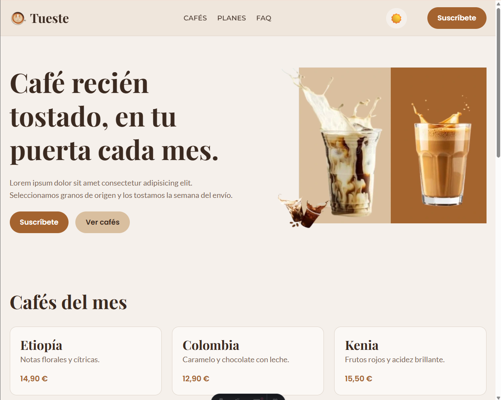
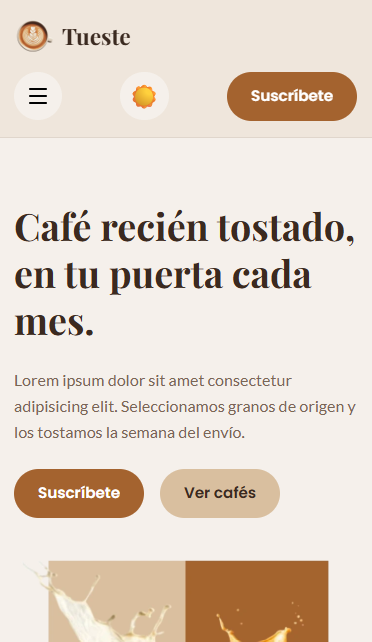
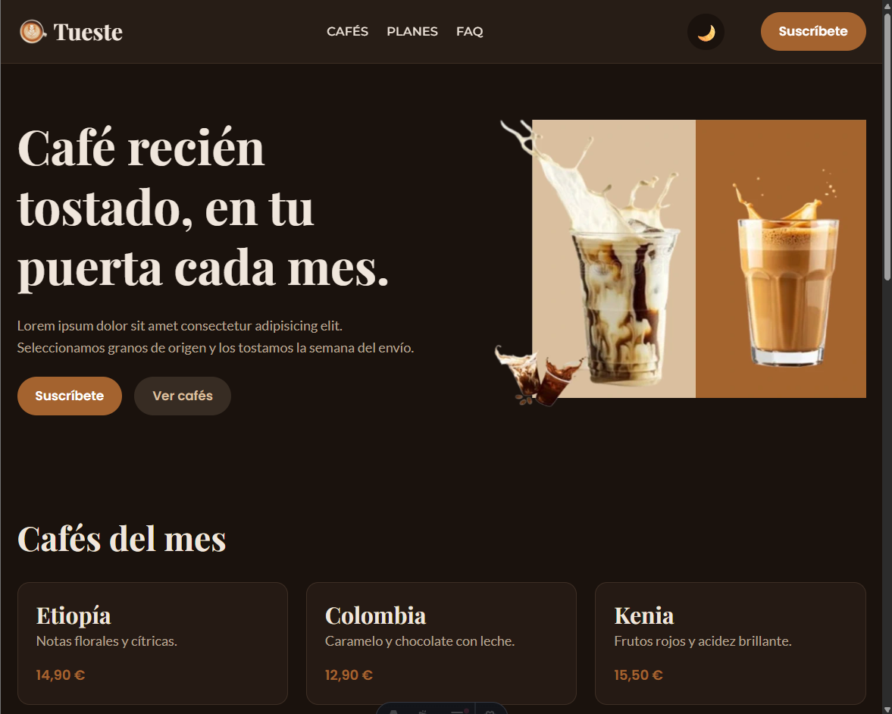
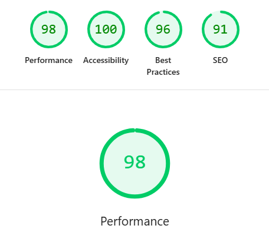
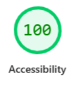
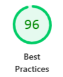
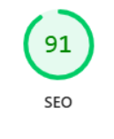
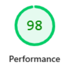
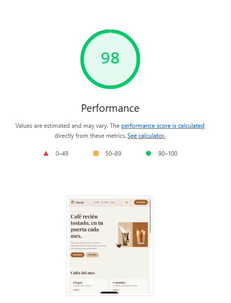
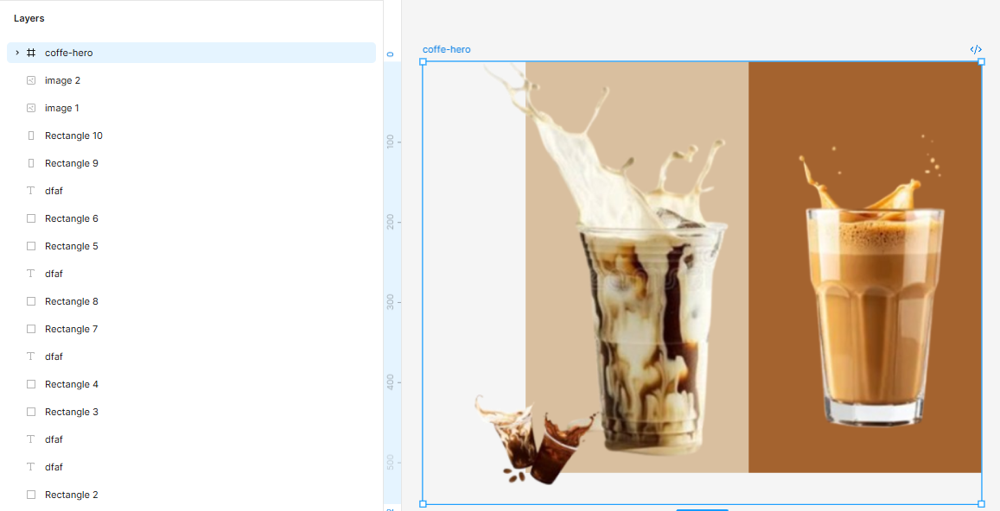

# ☕ Tueste — Tostadero de café de especialidad

> Landing page de **Tueste**, un pequeño tostadero ficticio que vende café de especialidad online por suscripción. Tonos cálidos de café, tipografía con carácter y una experiencia cómoda tanto en móvil como en escritorio.

---

## 👀 Sobre el proyecto

Laboratorio del **Módulo 01 · Layout + Tailwind CSS** (Lemoncode).

**Tema elegido:** 🅰️ Tema propuesto: -- *Tueste, tostadero de café de especialidad*.

La landing incluye cabecera con menú (con versión móvil), hero, cafés del mes, cómo funciona en 3 pasos, planes de suscripción con uno destacado, preguntas frecuentes y pie con enlaces, redes y newsletter.

---

## 🛠️ Tecnologías

| Tecnología | Uso |
| :--- | :--- |
| [Astro](https://astro.build) v7 | Framework — genera HTML estático, por debajo usa Vite |
| [Tailwind CSS](https://tailwindcss.com) v4 | Estilos utilitarios con design tokens propios en `@theme` |
| [Google Fonts](https://fonts.google.com) | Playfair Display, Lato, Poppins y Montserrat |
| [Lucide](https://lucide.dev) | Iconos del menú móvil |

---

## 🧞 Cómo arrancarlo

Desde la raíz del proyecto:

| Comando | Acción |
| :--- | :--- |
| `npm install` | Instala dependencias |
| `npm run dev` | Servidor de desarrollo en `localhost:4321` |
| `npm run build` | Build de producción en `./dist/` |
| `npm run preview` | Preview del build antes de desplegar |

---

## 🔌 Integración de Tailwind

**Opción 1: plugin de Vite** (`@tailwindcss/vite`).

Astro usa Vite por debajo, así que el plugin se registra en `astro.config.mjs` dentro de `vite.plugins`. Elegí esta opción porque es la más sencilla: no necesita `postcss.config.mjs` y es la que recomienda la documentación de Tailwind v4 para proyectos con Vite. Toda la configuración vive en el propio CSS (`src/styles/global.css`), sin `tailwind.config.js`.

---

## 🎨 Design tokens (`@theme`)

Todos los colores, fuentes y tamaños están definidos como variables en `@theme`, así Tailwind genera clases propias (`bg-accent`, `text-text-muted`, `font-heading`, `text-h1`…) y no hay colores "a pelo" repartidos por el HTML.

### Colores

| Token | Claro | Oscuro | Uso |
| :--- | :--- | :--- | :--- |
| `accent` | `#a4632f` | `#a4632f` | Caramelo tostado -- botones, precios, destacados |
| `accent-hover` | `#87501f` | `#b87333` | Hover del accent |
| `soft` | `#d9bf9f` | `#d9bf9f` | Latte -- botón secundario, detalles |
| `background` | `#f5f0eb` | `#1a120d` | Fondo general |
| `background-hover` | `#ebe2d8` | `#302219` | Hover de fondos |
| `surface` | `#fbf8f5` | `#251a14` | Tarjetas |
| `header` | `#ede3d8` | `#2b1f18` | Cabecera y sección de pasos |
| `footer` | `#1e1510` | `#1e1510` | Casi negro café |
| `border` | `#e0d6cc` | `#3d2e24` | Bordes |
| `text` | `#3b2a20` | `#f0e6dc` | Texto principal (espresso) |
| `text-muted` | `#7a6656` | `#b8a594` | Texto secundario |
| `cream` | `#f5f0eb` | `#f5f0eb` | Texto claro fijo del footer |

### Tipografías

| Token | Fuente | Uso |
| :--- | :--- | :--- |
| `font-heading` | Playfair Display | Títulos `h1`--`h3` |
| `font-body` | Lato | Párrafos y texto general |
| `font-button` | Poppins (600) | Botones y precios |
| `font-nav` | Montserrat (500) | Enlaces del menú |

### Tamaños de letra fluidos con `clamp()`

Los tamaños crecen de forma continua con el ancho de la pantalla, sin saltos por breakpoint:

| Token | Mínimo → Máximo |
| :--- | :--- |
| `text-h1` | 2.25rem → 4rem |
| `text-h2` | 1.75rem → 2.75rem |
| `text-h3` | 1.375rem → 1.875rem |
| `text-p` | 1rem → 1.125rem |
| `text-small` | 0.8125rem → 0.875rem |
| `text-nav` | 0.875rem → 1rem |
| `text-button` | 0.9375rem → 1.0625rem |

---

## 🧱 Capas de estilos (`@layer`)

- **`@layer base`** — estilos por defecto de las etiquetas:
  - `html` con **`scroll-smooth`**: los enlaces del menú (`#cafés`, `#planes`, `#faq`) bajan suave hasta su sección.
  - `body` con fondo, color, fuente y tamaño base.
  - `h1`, `h2`, `h3` con su fuente y tamaño fluido, para no repetir clases en cada título.
- **`@layer components`** — piezas que se repiten en varias secciones:
  - `.btn` → base de todos los botones (forma píldora, fuente, padding).
  - `.btn-primary` → botón principal en color accent.
  - `.btn-soft` → botón secundario en latte (con su variante en oscuro).
  - `.menu-link` → enlaces del header: en móvil son "filas" del menú desplegable y desde `md` vuelven a ser texto.

---

## 🌙 Modo oscuro

- Variante de Tailwind redefinida para que funcione por clase: `@custom-variant dark (&:where(.dark, .dark *));`
- El bloque `.dark { … }` **solo cambia el valor de las variables de color**, así que todas las clases (`bg-surface`, `text-text`…) se adaptan solas sin tocar el HTML. `dark:` se usa solo para casos puntuales (iconos, botón secundario).
- Botón ☀️ / 🌙 en la cabecera que pone o quita `.dark` en `<html>` y guarda la elección en `localStorage`.
- Si no hay elección guardada, sigue la preferencia del sistema (`prefers-color-scheme`).
- Un pequeño script en el `<head>` aplica el tema **antes de pintar** la página para evitar el parpadeo en claro.

---

## 🧭 Cabecera

- **Fija con efecto cristal:** `sticky top-0 z-50 bg-header/80 backdrop-blur-md`.
  - **¿Por qué `sticky` y no `fixed`?** `sticky` mantiene el header en el flujo del documento: ocupa su hueco y el contenido empieza debajo. Con `fixed` se sale y habría que poner un `padding-top` en el `main` para que no tape el hero.

  - **¿Por qué `z-50`?** Al hacer scroll, elementos posicionados o transformados (como el plan destacado con `scale-105`) crean su propio contexto de apilamiento y podrían pintarse por encima del header. El `z-index` asegura que el header quede siempre arriba.

- **Menú móvil:** botón hamburguesa (iconos Lucide) que despliega los enlaces a ancho completo. Se cierra al pulsar otra vez, al pinchar fuera o al elegir un enlace. El estado se guarda en un atributo `data-open` del header y los hijos reaccionan con `group-data-open:`.

- **Imagen del hero adaptada:** `<picture>` con una imagen distinta para móvil y para escritorio.

---

## 📸 Capturas

| Móvil | Escritorio |
| :---: | :---: |
|  |  |

|  | Dark |
| :---: | :---: |
|  |  |

> 📝 Nota: las capturas están en la carpeta `docs/`.

---

## ♿ Lighthouse

| Categoría | Nota | Evidencia |
| :--- | :--- | :--- |
| General | Mayor que 90 |  | 
| Accesibilidad | 100 |  |
| Buenas prácticas | 96 |  |
| SEO | 91 |  |
| Rendimiento | 98 |  |

---

## 🤖 Bitácora de IA

*Herramienta:* Claude Code (Claude Opus) dentro de VS Code.

### Prompt

"Pásame los dos colores principales estilo café, uno accent y otro más suave, el fondo, el borde… y los tamaños de letra con clamp. Ponlo en un CSS."

### Qué me dio

Un CSS normal con las variables en :root y selectores de etiqueta (header a, button…), sin Tailwind (que todavía no estaba instalado en el proyecto).

### Qué corregí y por qué

Al pasar a Tailwind moví todas las variables a @theme con los prefijos de v4 (--color-*, --font-*, --text-*), para que Tailwind genere clases propias (bg-accent, font-heading, text-h1) en vez de usar var(--…) a mano.

---

### Prompt (le pedí una mal formulada, me di cuenta y lo arreglé "era muy poco" agreglar el baseline en el grid del footer)

"El footer no tiene un alineamiento correcto" (con captura).

### Qué me dio

Cambió el tamaño y la fuente de los tres títulos del footer y creó una clase nueva .footer-title para unificarlos.

### Qué corregí y por qué

Le pedí volver atrás: las fuentes estaban bien, solo había que alinear los títulos en la misma línea base. Lo dejé con un único cambio, items-baseline en el grid del footer.

---

### Prompt

"Vamos a hacer el menú en móvil con estos iconos; se cierra al pinchar fuera o al pinchar otra vez."

### Qué me dio

El menú funcionando con group + group-data-open: y la clase md:order-none para devolver los enlaces a su sitio en escritorio.

### Qué corregí y por qué

Tailwind CSS IntelliSense avisó de que la forma canónica en v4 es md:order-0, así que la cambié. Además repasé por qué los iconos SVG necesitan dark:invert: dentro de un , currentColor no hereda el color del texto y se verían negros en modo oscuro.

---

## Imagen header 🖼️

He hecho la imagen del hero yo en figma, con los dos colores del theme.

---

## ✅ Checklist

### Obligatorios

- [x] **O1** · Estructura semántica — `header`, `nav`, `main`, `section`, `article`, `footer`, un solo `h1` y `alt` en imágenes ✅
- [x] **O2** · Tema visual propio con `@theme` (colores, 4 tipografías de Google Fonts, tamaños) ✅
- [x] **O3** · Cabecera con flexbox y hover ✅
- [x] **O4** · Hero en una columna en móvil y en dos desde `md` (grid) ✅
- [x] **O5** · Rejilla de tarjetas con grid (1 → 2 → 3 columnas) ✅
- [x] **O6** · Pasos en columna en móvil y en fila en escritorio ✅
- [x] **O7** · Pie con 3 columnas que se apilan y copyright separado con borde ✅
- [x] **O8** · Accesibilidad mínima ✅
- [x] **O9** · README + bitácora de IA ✅

### Opcionales

- [x] **P1** · Modo oscuro con botón y preferencia del sistema ✅
- [x] **P2** · Cabecera fija con efecto cristal ✅
- [x] **P3** · Plan destacado con borde y más grande ✅
- [x] **P4** · FAQ con `
` sin JS ✅
- [ ] **P5** · Formulario con estados
- [ ] **P6** · Bento grid
- [x] **P7** · Animaciones con `motion-safe:` ✅

### Desafíos

- [ ] **D1** · Menú hamburguesa sin JavaScript ✅ (el actual usa JS)
- [ ] **D2** · Container queries
- [ ] **D3** · Multitema
- [ ] **D4** · Utilidades propias con `@utility`
- [ ] **D5** · Layout de aplicación
- [ ] **D6** · De captura a código
- [ ] **D7** · Lighthouse al 100 ✅ · Al 98, no llega a 100

---

*Hecho con ☕ para el laboratorio de Lemoncode*
